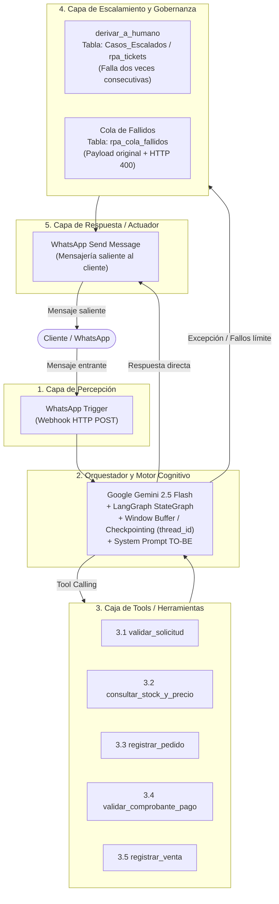
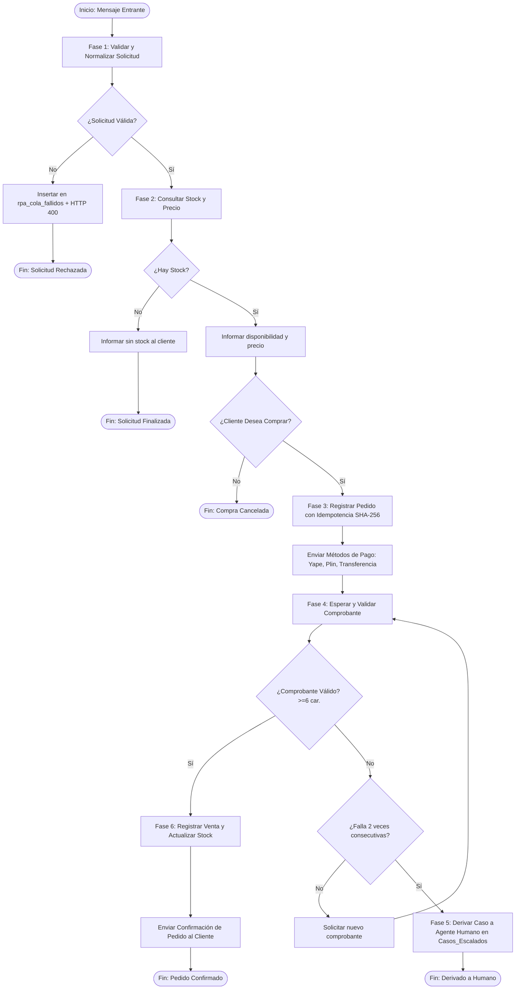

# 🤖 AGENTS.md — Sistema Multi-Agente e Inteligencia de Procesos (IPA)
## FARRO MENDEZ CORPORATION S.A.C. — Automatización de Pedidos por Canal Digital

Este documento define la arquitectura técnica, especificación de diseño, contratos de datos, catálogo de agentes y reglas de orquestación para la plataforma de Automatización Inteligente de Procesos (IPA) de **FARRO MENDEZ CORPORATION S.A.C.**, desarrollada conforme a los lineamientos del curso *Automatización Inteligente de Procesos (UPAO 2026)* y los estándares de orquestación con **LangChain Core, LCEL y LangGraph**.

---

## 1. 🏢 Contexto Organizacional y Diagnóstico Operativo

### 1.1 Perfil de la Empresa
* **Razón Social:** FARRO MENDEZ CORPORATION S.A.C.
* **Sector:** Comercio minorista / Minimarket.
* **Canal Crítico:** Recepción y atención de pedidos digitales vía WhatsApp.
* **Volumen:** 40 a 50 pedidos mensuales estabilizados.

### 1.2 Línea Base del Proceso AS-IS (Magnitudes de Operación)
El relevamiento del proceso tradicional manual evidenció severas ineficiencias y tiempos muertos:

| Magnitud | Valor AS-IS | Valor Meta TO-BE | Impacto / Justificación |
| :--- | :--- | :--- | :--- |
| **Tiempo de Ciclo (Mediana)** | 1.56 horas | < 2.0 minutos | Reducción de esperas inactivas al consultar stock. |
| **Tiempo de Ciclo (Máximo)** | 2.20 horas | < 5.0 minutos | Eliminación de reprocesos por quiebres o falta de respuesta. |
| **Trabajo Efectivo por Caso** | 16.30 minutos | < 30 segundos | Automatización de tareas cognitivas y operativas. |
| **Eficiencia del Ciclo (PCE)** | 17.50 % | > 90 % | Relación trabajo efectivo vs. tiempo total de ciclo. |
| **Tasa de Reprocesos** | 35.00 % | ≈ 0.00 % | Erradicación de errores de transcripción e inconsistencias de inventario. |
| **Costo Horario del Rol** | S/ 9.05 / hora | S/ 9.05 / hora | Base de remuneración del personal de ventas. |
| **Costo Unitario por Pedido**| S/ 12,546.11* | Marginal (Cloud/API) | Sobrecostos acumulados por tiempos muertos y reprocesos. |

### 1.3 Principales Puntos de Dolor Identificados
1. **Silos de Información y Verificación Manual:** El vendedor no tiene visibilidad directa del inventario y debe consultar físicamente o por kardex manual con el encargado de almacén.
2. **Fricción y Retardo:** Esperas de 1.5 a 2.2 horas degradan drásticamente la experiencia del cliente.
3. **Alta Tasa de Errores (35%):** Discrepancias de precios o cantidades llevan a rehacer la orden, recontactar al cliente y reprocesar el pedido.

---

## 2. 🏛️ Arquitectura del Sistema TO-BE (5 Capas)

Conforme al modelo de arquitectura y diagramación de flujo, la plataforma opera a través de 5 capas integradas:



### Detalle de Capas:
1. **Capa 1: Percepción:** Receptor HTTP Webhook que captura los mensajes entrantes de WhatsApp Cloud API (texto o archivos multimedia como comprobantes de pago) y normaliza la carga.
2. **Capa 2: Orquestador y Motor Cognitivo:** Modelo central `Google Gemini 2.5 Flash` con memoria de corto plazo (`Window Buffer Memory` o persistencia con Checkpointing por `thread_id` en LangGraph), guiado por un System Prompt con reglas estrictas de negocio y del flujo BPMN TO-BE.
3. **Capa 3: Herramientas (Tools):** Funciones Python decoradas con `@tool` y tipos estrictos de Pydantic, que ejecutan las consultas e inserciones en PostgreSQL.
4. **Capa 4: Escalamiento y Gobernanza:** Detección de anomalías, registro en cola de fallidos (`rpa_cola_fallidos`) ante violaciones de contrato de datos, y escalamiento humano (`derivar_a_humano`) guardando en `Casos_Escalados` ante dos comprobantes inválidos consecutivos.
5. **Capa 5: Respuesta / Actuador:** Envío de mensajes estructurados y oportunos de WhatsApp hacia el cliente con estado, precios y confirmaciones.

---

## 3. 🗺️ Flujo BPMN 2.0 TO-BE (Mapeo de Fases y Carriles)

El proceso modelado consta de 2 carriles principales de interacción directa y 1 carril de soporte:
* **Lane Cliente:** Inicia la consulta por WhatsApp, recibe disponibilidad y precio, confirma compra, envía comprobante de pago y recibe la confirmación.
* **Lane Chatbot (Gemini):** Reemplaza las tareas manuales del vendedor y del encargado de almacén.
* **Lane Personal de Back-Office:** Recibe casos derivados por dos fallos consecutivos de comprobante o incidencias en cola de fallidos.

### Fases Operativas del Agente (Lane Chatbot):



---

## 4. 📋 Especificaciones y Contratos de Datos (Instrumento Lab 2)

### 4.1 Contrato de Datos de la Entrada
Toda petición entrante debe validarse contra este esquema estricto antes de cualquier interacción con la base de datos:

| Campo | Tipo | ¿Obligatorio? | Restricción / Rango | Acción ante fallo o no validación | Ejemplo Válido |
| :--- | :--- | :--- | :--- | :--- | :--- |
| `accion` | `string` | **Sí** | Valores permitidos: `consulta`, `compra`, `pago`. | Rechazar con HTTP 400 y registrar incidente en `rpa_cola_fallidos` con carga original. | `"consulta"` |
| `producto`| `string` | Condicional | Obligatorio para `accion=consulta` o `accion=compra`. Código (P001, P002, P003) o nombre reconocible. | Responder 400 y registrar en cola de fallidos con payload original. | `"P001"` |
| `cliente` | `string` | Condicional | Obligatorio para `accion=compra`. Texto identificador o número telefónico. | Responder 400 y registrar en cola de fallidos con payload original. | `"51987654321"` |
| `cantidad`| `number` | Condicional | Obligatorio para `accion=compra`. Entero entre 1 y 500. | Responder 400 y registrar en cola de fallidos con payload original. | `2` |
| `decision`| `string` | Condicional | Obligatorio para `accion=compra`. Valores permitidos: `si`, `no`. | Responder 400 y registrar en cola de fallidos con payload original. | `"si"` |
| `pedido_id`| `string`| Condicional | Obligatorio para `accion=pago`. Identificador del pedido generado previamente. | Responder 400 y registrar en cola de fallidos con payload original. | `"PED-20261029-ABCD"`|
| `comprobante`| `string`| Condicional | Obligatorio para `accion=pago`. Texto de referencia de pago, no vacío. Longitud $\ge$ 6 caracteres. | Si viene vacío: HTTP 400 y registrar en cola de fallidos. Si viene con menos de 6 caracteres: se rechaza la validez del comprobante y se pide uno nuevo. | `"OPE987654"` |

> [!IMPORTANT]
> **Regla de Transformación:** Todas las transformaciones y validaciones preceden a la primera acción de negocio. Ninguna escritura en base de datos (`rpa_pedidos`, `rpa_ventas`) ocurre con datos incompletos o inválidos.

---

### 4.2 Diseño de la Clave de Idempotencia
Para evitar compras duplicadas por reintentos de red o envíos múltiples del cliente:

* **Expresión de la Clave:**
  $$\text{clave\_idempotencia} = \text{SHA-256}(\text{accion} \,|\, \text{producto} \,|\, \text{cliente} \,|\, \text{cantidad})$$
* **Campos excluidos deliberadamente:**
  * `timestamp` / `Date.now()` (variaría entre reintentos idénticos, anulando la protección).
  * `pedido_id` (se genera como resultado del proceso, no es un dato de entrada del negocio).
  * `estado_procesamiento` (muta durante el ciclo de vida del pedido).
* **Comportamiento ante colisión:** Si entra una solicitud idéntica consecutiva, el sistema no duplica el pedido: localiza el registro existente y devuelve HTTP 200 con el `pedido_id` original.

---

### 4.3 Catálogo de Errores y Estrategia de Resiliencia

| N° | Error Previsible | Nodo / Componente | Clase | Respuesta Correcta | ¿Reintenta? | Intentos y Espera |
| :---: | :--- | :--- | :--- | :--- | :---: | :--- |
| 1 | Solicitud llega sin campo `accion` | Normalizar Entrada | **De datos** | Registrar en cola de revisión + HTTP 400 | No | No aplica |
| 2 | Campo con tipo de dato inválido | Normalizar Entrada | **De datos** | Registrar en cola de revisión + HTTP 400 | No | No aplica |
| 3 | Acción no contemplada en catálogo | Router de Fase | **De datos** | Registrar en cola de revisión + HTTP 400 | No | No aplica |
| 4 | Producto solicitado no existe en catálogo | Consultar Stock y Catálogo | **De datos** | Responder informando producto no existente | No | No aplica |
| 5 | Comprobante de pago vacío en `accion=pago` | Validar Contrato Entrada | **De datos** | Registrar en cola de revisión + HTTP 400 | No | No aplica |
| 6 | Cliente envía comprobante inválido 2da vez consecutiva | Contar Intentos Comprobante | **De sistema** | Detener flujo y derivar a `Casos_Escalados` con notificación simulada | No | No aplica |
| 7 | `pedido_id` no existe o no fue enviado en pago | Validar Comprobante | **De datos** | Registrar en cola de revisión + HTTP 400 | No | No aplica |
| 8 | Error interno no recuperable / credencial caída | Conexión BD o LLM | **De sistema** | Alertar al responsable y pausar nodo | No | No aplica |
| 9 | Fallo temporal / timeout consultando BD/catálogo | Consultar Stock / Pedidos | **Transitorio** | Reintentar con retroceso exponencial | Sí | 3 intentos (1s, 2s, 4s) |

---

## 5. 🛠️ Catálogo de Agentes y Herramientas (Tools)

### 5.1 Especificación de Tools (@tool)

#### Tool 1: `validar_solicitud`
* **Propósito:** Evalúa el mensaje inicial del cliente, extrayendo intención de consulta o compra y normalizando según el contrato de datos.
* **Firma:** `validar_solicitud_tool(query: str) -> str`
* **Salida esperada:** JSON estructurado con `{ valida: bool, accion: str, producto: str, cantidad: int, motivo: str }`.

#### Tool 2: `consultar_stock_y_precio`
* **Propósito:** Accede al almacén `Inventario` en PostgreSQL para obtener existencias, precio y código de productos (P001, P002, P003).
* **Firma:** `consultar_stock_y_precio(producto_query: str) -> str`
* **Salida esperada:** JSON con disponibilidad, stock exacto y precio unitario o mensaje de quiebre de stock.

#### Tool 3: `registrar_pedido`
* **Propósito:** Genera el registro de pedido en `rpa_pedidos` aplicando validación de idempotencia por SHA-256.
* **Firma:** `registrar_pedido(cliente: str, product_id: str, producto_nombre: str, cantidad: int, precio_unitario: float) -> str`
* **Salida esperada:** JSON con `pedido_id`, `idempotency_hash`, `monto_total`, `estado` ('Pendiente de pago') y métodos de pago disponibles.

#### Tool 4: `validar_comprobante_pago`
* **Propósito:** Verifica que el comprobante remitido sea válido (longitud $\ge$ 6 caracteres alfanuméricos) y verifica la existencia del `pedido_id`.
* **Firma:** `validar_comprobante_pago(pedido_id: str, comprobante_texto: str) -> str`
* **Salida esperada:** JSON con `{ valido: bool, motivo: str, comprobante: str }`.

#### Tool 5: `registrar_venta`
* **Propósito:** Concreta la transacción comercial, inserta en `rpa_ventas`, actualiza el stock en `Inventario` (`stock_nuevo = stock_anterior - cantidad`) y marca el pedido como `pagado`.
* **Firma:** `registrar_venta(pedido_id: str, cliente: str, monto: float, operacion: str) -> str`
* **Salida esperada:** JSON con `venta_id`, `pedido_id`, `stock_actualizado` y mensaje de confirmación de compra.

#### Tool 6: `derivar_a_humano`
* **Propósito:** Escalamiento de excepciones cuando se acumulan 2 fallos consecutivos de comprobante.
* **Firma:** `derivar_a_humano(cliente: str, pedido_id: str, motivo: str) -> str`
* **Salida esperada:** Registro en `Casos_Escalados` / `rpa_tickets` y notificación al personal de Back-Office.

---

## 6. 🧠 Orquestación Avanzada: De Chains a LangGraph

Conforme a la Sesión 09 (Arquitectura 2026), el sistema soporta dos modalidades complementarias:

### 6.1 LCEL (LangChain Expression Language) para Pipelines Lineales
Utilizado para transformaciones atómicas y extracción estructurada de datos mediante:
```python
chain = prompt | llm.with_structured_output(ContratoEntrada)
```

### 6.2 LangGraph para Flujos Cíclicos y Memoria Persistente
Para la orquestación integral del proceso de pedidos digitales, se implementa `StateGraph` con las 3 características críticas:
1. **Ramas (Decisiones Condicionales):** Bifurcación entre stock suficiente vs. sin stock, comprobante válido vs. inválido.
2. **Ciclos de Auto-Corrección:** Bucle de reintento de comprobante con corte de seguridad estricto (máximo 2 intentos antes de derivar a humano).
3. **Estado Compartido y Checkpointing (Persistencia & HITL):**
   * Estado tipado con `TypedDict` (`pregunta`, `cliente`, `fase`, `intentos_comprobante`, `pedido_id`, etc.).
   * Checkpointer (`InMemorySaver` / `SqliteSaver` / `PostgresSaver`) mapeado por `thread_id` (número telefónico del cliente) para mantener la memoria a lo largo de múltiples mensajes de WhatsApp sin pérdida de estado.
   * Capacidad de **Human-in-the-loop (HITL)** para auditoría de casos escalados.

---

## 7. 🧪 Banco de Pruebas Automatizadas (Suite E2)

Para la acreditación completa del entregable E2 del laboratorio, el sistema debe superar al 100% las 4 pruebas del banco:

| Prueba | Objetivo de Verificación | Resultado Esperado | Código HTTP |
| :---: | :--- | :--- | :---: |
| **P1: Validación** | 5 solicitudes mal formadas (falta de campos obligatorios o tipos incorrectos según contrato). | Las 5 solicitudes son rechazadas. Se registra el incidente en `rpa_cola_fallidos` con la carga original. | **400 Bad Request** |
| **P2: Idempotencia** | Envío consecutivo de dos solicitudes de compra con datos idénticos de negocio. | Se genera un único registro de pedido. La segunda petición responde exitosamente asociando el `pedido_id` existente. | **200 OK** |
| **P3: Cola de Fallidos** | Envío de una solicitud deliberadamente inválida. | Entrada creada en `rpa_cola_fallidos` con los 6 campos mínimos auditables y el payload íntegro. | **400 Bad Request** |
| **P4: Códigos de Respuesta**| Envío de una entrada válida y una entrada inválida de cada clase. | Entrada válida retorna código de éxito; entrada inválida retorna código de error de contrato. | **200 / 201 vs 400** |

---

## 8. 👥 Equipo y Trazabilidad del Proyecto
* **Organización:** FARRO MENDEZ CORPORATION S.A.C.
* **Curso:** Automatización Inteligente de Procesos — UPAO (2026)
* **Docente:** Dr. Luis Vladimir Urrelo Huiman
* **Integrantes del Equipo:**
  * Salas Torres, Juan Carlos (Calidad y Gobernanza)
  * Silvestre Miguel, Alex (Rotativo / Implementación)
  * Rodríguez Toral, Jhon André (Calidad y Gobernanza)
  * Rodríguez Zavaleta, Jheyson (Analista de Proceso)
