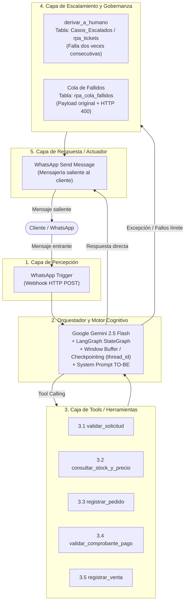
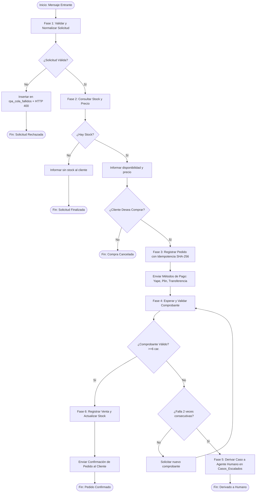

# 🤖 AGENTS.md — Sistema Multi-Agente e Inteligencia de Procesos (IPA)
## FARRO MENDEZ CORPORATION S.A.C. — Automatización de Pedidos por Canal Digital

Este documento define la arquitectura técnica, especificación de diseño, contratos de datos, catálogo de agentes y reglas de orquestación para la plataforma de Automatización Inteligente de Procesos (IPA) de **FARRO MENDEZ CORPORATION S.A.C.**, desarrollada conforme a los lineamientos del curso *Automatización Inteligente de Procesos (UPAO 2026)* y los estándares de orquestación con **LangChain Core, LCEL y LangGraph**.

---

## 1. 🏢 Contexto Organizacional y Diagnóstico Operativo

### 1.1 Perfil de la Empresa
* **Razón Social:** FARRO MENDEZ CORPORATION S.A.C.
* **Sector:** Comercio minorista / Minimarket.
* **Canal Crítico:** Recepción y atención de pedidos digitales vía WhatsApp.
* **Volumen:** 40 a 50 pedidos mensuales estabilizados.

### 1.2 Línea Base del Proceso AS-IS (Magnitudes de Operación)
El relevamiento del proceso tradicional manual evidenció severas ineficiencias y tiempos muertos:

| Magnitud | Valor AS-IS | Valor Meta TO-BE | Impacto / Justificación |
| :--- | :--- | :--- | :--- |
| **Tiempo de Ciclo (Mediana)** | 1.56 horas | < 2.0 minutos | Reducción de esperas inactivas al consultar stock. |
| **Tiempo de Ciclo (Máximo)** | 2.20 horas | < 5.0 minutos | Eliminación de reprocesos por quiebres o falta de respuesta. |
| **Trabajo Efectivo por Caso** | 16.30 minutos | < 30 segundos | Automatización de tareas cognitivas y operativas. |
| **Eficiencia del Ciclo (PCE)** | 17.50 % | > 90 % | Relación trabajo efectivo vs. tiempo total de ciclo. |
| **Tasa de Reprocesos** | 35.00 % | ≈ 0.00 % | Erradicación de errores de transcripción e inconsistencias de inventario. |
| **Costo Horario del Rol** | S/ 9.05 / hora | S/ 9.05 / hora | Base de remuneración del personal de ventas. |
| **Costo Unitario por Pedido**| S/ 12,546.11* | Marginal (Cloud/API) | Sobrecostos acumulados por tiempos muertos y reprocesos. |

### 1.3 Principales Puntos de Dolor Identificados
1. **Silos de Información y Verificación Manual:** El vendedor no tiene visibilidad directa del inventario y debe consultar físicamente o por kardex manual con el encargado de almacén.
2. **Fricción y Retardo:** Esperas de 1.5 a 2.2 horas degradan drásticamente la experiencia del cliente.
3. **Alta Tasa de Errores (35%):** Discrepancias de precios o cantidades llevan a rehacer la orden, recontactar al cliente y reprocesar el pedido.

---

## 2. 🏛️ Arquitectura del Sistema TO-BE (5 Capas)

Conforme al modelo de arquitectura y diagramación de flujo, la plataforma opera a través de 5 capas integradas:

---

## 3. 🗺️ Flujo BPMN 2.0 TO-BE (Mapeo de Fases y Carriles)

El proceso modelado consta de 2 carriles principales de interacción directa y 1 carril de soporte:
* **Lane Cliente:** Inicia la consulta por WhatsApp, recibe disponibilidad y precio, confirma compra, envía comprobante de pago y recibe la confirmación.
* **Lane Chatbot (Gemini):** Reemplaza las tareas manuales del vendedor y del encargado de almacén.
* **Lane Personal de Back-Office:** Recibe casos derivados por dos fallos consecutivos de comprobante o incidencias en cola de fallidos.

### Fases Operativas del Agente (Lane Chatbot):

---

## 4. 📋 Especificaciones y Contratos de Datos (Instrumento Lab 2)

### 4.1 Contrato de Datos de la Entrada
Toda petición entrante debe validarse contra este esquema estricto antes de cualquier interacción con la base de datos:

| Campo | Tipo | ¿Obligatorio? | Restricción / Rango | Acción ante fallo o no validación | Ejemplo Válido |
| :--- | :--- | :--- | :--- | :--- | :--- |
| `accion` | `string` | **Sí** | Valores permitidos: `consulta`, `compra`, `pago`. | Rechazar con HTTP 400 y registrar incidente en `rpa_cola_fallidos` con carga original. | `"consulta"` |
| `producto`| `string` | Condicional | Obligatorio para `accion=consulta` o `accion=compra`. Código (P001, P002, P003) o nombre reconocible. | Responder 400 y registrar en cola de fallidos con payload original. | `"P001"` |
| `cliente` | `string` | Condicional | Obligatorio para `accion=compra`. Texto identificador o número telefónico. | Responder 400 y registrar en cola de fallidos con payload original. | `"51987654321"` |
| `cantidad`| `number` | Condicional | Obligatorio para `accion=compra`. Entero entre 1 y 500. | Responder 400 y registrar en cola de fallidos con payload original. | `2` |
| `decision`| `string` | Condicional | Obligatorio para `accion=compra`. Valores permitidos: `si`, `no`. | Responder 400 y registrar en cola de fallidos con payload original. | `"si"` |
| `pedido_id`| `string`| Condicional | Obligatorio para `accion=pago`. Identificador del pedido generado previamente. | Responder 400 y registrar en cola de fallidos con payload original. | `"PED-20261029-ABCD"`|
| `comprobante`| `string`| Condicional | Obligatorio para `accion=pago`. Texto de referencia de pago, no vacío. Longitud $\ge$ 6 caracteres. | Si viene vacío: HTTP 400 y registrar en cola de fallidos. Si viene con menos de 6 caracteres: se rechaza la validez del comprobante y se pide uno nuevo. | `"OPE987654"` |

> [!IMPORTANT]
> **Regla de Transformación:** Todas las transformaciones y validaciones preceden a la primera acción de negocio. Ninguna escritura en base de datos (`rpa_pedidos`, `rpa_ventas`) ocurre con datos incompletos o inválidos.

---

### 4.2 Diseño de la Clave de Idempotencia
Para evitar compras duplicadas por reintentos de red o envíos múltiples del cliente:

* **Expresión de la Clave:**
  $$\text{clave\_idempotencia} = \text{SHA-256}(\text{accion} \,|\, \text{producto} \,|\, \text{cliente} \,|\, \text{cantidad})$$
* **Campos excluidos deliberadamente:**
  * `timestamp` / `Date.now()` (variaría entre reintentos idénticos, anulando la protección).
  * `pedido_id` (se genera como resultado del proceso, no es un dato de entrada del negocio).
  * `estado_procesamiento` (muta durante el ciclo de vida del pedido).
* **Comportamiento ante colisión:** Si entra una solicitud idéntica consecutiva, el sistema no duplica el pedido: localiza el registro existente y devuelve HTTP 200 con el `pedido_id` original.

---

### 4.3 Catálogo de Errores y Estrategia de Resiliencia

| N° | Error Previsible | Nodo / Componente | Clase | Respuesta Correcta | ¿Reintenta? | Intentos y Espera |
| :---: | :--- | :--- | :--- | :--- | :---: | :--- |
| 1 | Solicitud llega sin campo `accion` | Normalizar Entrada | **De datos** | Registrar en cola de revisión + HTTP 400 | No | No aplica |
| 2 | Campo con tipo de dato inválido | Normalizar Entrada | **De datos** | Registrar en cola de revisión + HTTP 400 | No | No aplica |
| 3 | Acción no contemplada en catálogo | Router de Fase | **De datos** | Registrar en cola de revisión + HTTP 400 | No | No aplica |
| 4 | Producto solicitado no existe en catálogo | Consultar Stock y Catálogo | **De datos** | Responder informando producto no existente | No | No aplica |
| 5 | Comprobante de pago vacío en `accion=pago` | Validar Contrato Entrada | **De datos** | Registrar en cola de revisión + HTTP 400 | No | No aplica |
| 6 | Cliente envía comprobante inválido 2da vez consecutiva | Contar Intentos Comprobante | **De sistema** | Detener flujo y derivar a `Casos_Escalados` con notificación simulada | No | No aplica |
| 7 | `pedido_id` no existe o no fue enviado en pago | Validar Comprobante | **De datos** | Registrar en cola de revisión + HTTP 400 | No | No aplica |
| 8 | Error interno no recuperable / credencial caída | Conexión BD o LLM | **De sistema** | Alertar al responsable y pausar nodo | No | No aplica |
| 9 | Fallo temporal / timeout consultando BD/catálogo | Consultar Stock / Pedidos | **Transitorio** | Reintentar con retroceso exponencial | Sí | 3 intentos (1s, 2s, 4s) |

---

## 5. 🛠️ Catálogo de Agentes y Herramientas (Tools)

### 5.1 Especificación de Tools (@tool)
1. **`validar_solicitud_tool(query: str) -> str`**: Valida y normaliza según el contrato de datos.
2. **`consultar_stock_y_precio(producto_query: str) -> str`**: Consulta en vivo el inventario (P001, P002, P003) sin alucinaciones.
3. **`registrar_pedido(...) -> str`**: Inserción protegida por idempotencia SHA-256 (`accion|producto|cliente|cantidad`).
4. **`validar_comprobante_pago(pedido_id: str, comprobante_texto: str) -> str`**: Regla de validez ($\ge$ 6 caracteres).
5. **`registrar_venta(pedido_id: str, cliente: str, monto: float, operacion: str) -> str`**: Cierre de venta, descuento de stock y estado `pagado`.
6. **`derivar_a_humano(cliente: str, pedido_id: str, motivo: str) -> str`**: Escalamiento controlado a supervisor y registro en `Casos_Escalados`.

---

## 6. 🧠 Orquestación Avanzada: De Chains a LangGraph (Sesión 09)

* **LCEL (LangChain Expression Language):** Composición declarativa para parsers y estructuración Pydantic.
* **LangGraph StateGraph:**
  * Estado (`TypedDict`): `EstadoPedido` con memoria de turnos y campos del contrato.
  * Checkpointing (`InMemorySaver` / `SqliteSaver` / `PostgresSaver`): Asociado a `thread_id` (teléfono de WhatsApp).
  * Human-in-the-loop (HITL): Interrupciones y supervisión humana con `interrupt_before`.

---

## 7. 🧪 Banco de Pruebas Automatizadas (Suite E2)
* **P1: Validación (HTTP 400):** 5 solicitudes mal formadas que violan el contrato de datos.
* **P2: Idempotencia (HTTP 200 sin duplicar):** Dos envíos de compra idénticos que devuelven el mismo `pedido_id`.
* **P3: Cola de Fallidos:** Verificación de registro con los 6 campos mínimos auditables y carga original.
* **P4: Códigos de Respuesta:** Respuestas HTTP diferenciadas (200/201 vs 400).
